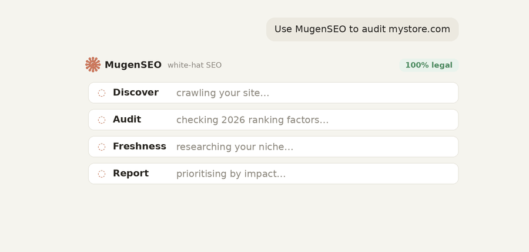

<p align="center">
  
</p>

<h1 align="center">MugenSEO (無限SEO)</h1>
<p align="center"><em>A white-hat SEO brain for your AI agent. No app, no API key — just knowledge and a workflow your AI runs itself.</em></p>

<p align="center">
  
</p>

---

**MugenSEO is a skill, not a program.** You don't install software or plug in an
API key. It's a package of expert, up-to-date (2026) SEO knowledge plus a
step-by-step workflow that an AI agent — Claude, Claude Code, or any capable
assistant — reads and then executes *using the tools it already has* (web search,
reading/writing files, a browser, your connectors).

Point your AI at this skill and it becomes a senior, ethical SEO consultant that:

- **Audits your site** — technical health, Core Web Vitals, on-page, crawlability.
- **Generates the files you need** — valid `sitemap.xml`, `robots.txt`, and
  structured-data (schema) markup.
- **Optimizes content & writes blog posts** — matched to real search intent, built
  for both Google and AI answers (AI Overviews, ChatGPT, Perplexity).
- **Connects the real data sources** — Google Search Console & Bing Webmaster
  (the legitimate way to measure rankings — never scraping).
- **Runs on a loop** — a recurring every-few-days check-in that re-audits,
  researches fresh news in your niche, and proposes what to change next.
- **Asks permission before every change.** Nothing is applied until you approve it.

## The one promise: 100% legal, white-hat SEO

MugenSEO will **never** do anything that breaks a search engine's rules — no
automated or bought backlinks, no link schemes, no scraping Google, no cloaking,
no mass AI-spun thin content. Those tactics get sites **penalized or deindexed**,
which is the opposite of the goal. If you ask for one (people often don't know
it's against the rules), it explains why it would hurt you and does the
legitimate version instead. See [`references/legal-guardrails.md`](references/legal-guardrails.md).

## How to use it

**With Claude / Claude Code (or a similar agent that supports skills):**
1. Clone this repo, or drop the `mugen-seo` folder into your agent's skills directory.
2. Ask your agent to run MugenSEO on your site: *"Use MugenSEO to audit example.com."*
3. It reads [`SKILL.md`](SKILL.md), asks a couple of setup questions, and begins.

**With any AI assistant:**
Paste or point it at [`SKILL.md`](SKILL.md) and say which site to work on. The
skill tells the AI exactly what to do, in what order, and where to stop for your
approval.

You'll be asked three things up front: your **site URL**, **what it's about**,
and **how changes should be applied** — report-only (works for any site), direct
file edits, or through your CMS.

## What's inside

```
SKILL.md                         The workflow the AI follows (start here)
references/
  legal-guardrails.md            White-hat vs black-hat — read first, always
  ranking-factors-2026.md        What actually moves rankings now
  technical-seo-checklist.md     The full technical/on-page audit
  geo-ai-overviews.md            Getting cited in AI answers (GEO)
  content-and-blog.md            Content strategy, blog posts, freshness
  sitemap-robots.md              Generating & validating the files
  search-console-bing.md         Connecting & using the official data
  the-3-day-loop.md              The recurring check-in workflow
templates/
  schema-*.json                  Ready JSON-LD (Article, FAQ, HowTo, Organization)
  sitemap.xml, robots.txt        File templates
  audit-report.md                The report format
```

## Part of the Mugen family

MugenSEO's sister project is **[Mugen](https://github.com/Joy-infinity/Mugen)** —
a tarpit that traps hostile bots. They're two sides of the same coin: MugenSEO
*invites* the search and AI crawlers you want, while Mugen *traps* the malicious
ones. Infinity, both ways. ∞

## Support MugenSEO

MugenSEO is free and open source, and always will be. If it helped your site
climb, you can fuel the infinite loop with a little crypto — every bit keeps the
void spinning. 🌀

- **EVM (ETH, BNB, and USDT/USDC on those networks):**
  `0x54b45AC3c26EE8C3d3823eD3B7d0AA19F7a95479`
- **Solana (SOL, and USDT/USDC on Solana):**
  `5RaSo1uZ1RyZaSq5FcMnzRFyC2KpDuRnJpVURfA8rnCV`
- **BTC:** `bc1qhecrn9glsp79scjvaxjp2cx2adn84y0w3pwu6n`
- **TRON (TRX, and USDT-TRC20):** `TBorbUQYyWAF3625FXbQZkUDeM3sCtbbwn`

Thank you for keeping SEO honest. ∞

---

## License

MIT — see [LICENSE](LICENSE). Contributions welcome. MugenSEO gives SEO guidance,
not guarantees; no honest SEO can promise specific rankings.
